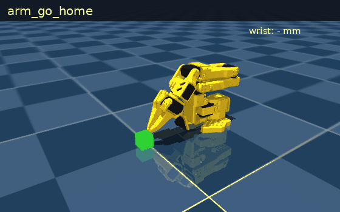
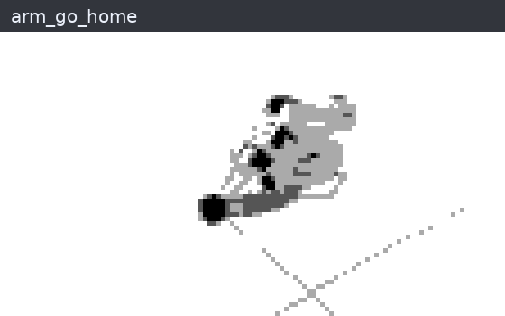

# so101-arm: give Hermes a robot arm, safely

A [Hermes Agent](https://github.com/NousResearch/hermes-agent) plugin that lets the agent work an SO-101 robot arm:
- pick things up;
- look at the table through a camera with a 10 mm grid, and correct its own aim;
- heal the arm when a sensor or a joint fails.

It runs on your laptop against a MuJoCo twin of the arm. The same arm host has a driver for a real SO-101 through [LeRobot](https://github.com/huggingface/lerobot), which hasn't been run on hardware yet.



*Scripted in the sim with the same skills the tools call. Someone bumps the block 30 mm and the pick closes on nothing. `arm_look` shows the offset on the grid, a preview checks the new aim, and the corrected pick holds. [Measured in the sim](#measured-in-the-sim) shows a vision model reading these maps blind.*

The model never sends joint angles and never sits in the control loop:
- it chooses named skills;
- plain code checks every reading and parks the arm on a fault;
- motion stays refused until a repair passes a check;
- no tool can lift a freeze. A person's `/arm unfreeze` does.

## What it does

- **Moves by skills.**
  - `arm_go_home`, `arm_reach`, `arm_approach`, `arm_grip`, `arm_lift`, `arm_release`, `arm_park`.
  - `arm_pick_up` runs approach, grip and lift, checking after each.
  - `arm_play` plays a motion taught on the arm; the sim ships a wave.
- **Looks and corrects.**
  - `arm_look` returns a top-down map of the table: a 10 mm grid, a red + where the arm will aim, and a blue x where the jaws are.
  - The image comes back inside the tool result, so a vision model reads it directly. Any other model gets a text summary that points it at `vision_analyze`.
  - The agent passes the offset it reads as `dx_mm`/`dy_mm`, and the arm host refuses anything past 40 mm per axis.
- **Heals.**
  - A watchdog in plain code checks every reading: a frozen or stuck distance sensor, a distance that disagrees with the arm's pose, a joint that stalls, a servo alarm.
  - On a fault it parks the arm and opens an incident.
  - The agent fixes the cause (`arm_restart_sensor`, `arm_check`). The watchdog verifies the fix at home, and the job carries on.
  - A joint that still won't move goes to a person (`arm_handoff`).
- **Stops for people.** `/arm freeze` parks the arm and refuses every move until a person types `/arm unfreeze`.

| A frozen wrist sensor: parked, restarted, verified, resumed | A dead elbow servo: checked once more, then handed to a person |
|---|---|
|  |  |

*Both scripted in the sim like the one above; the host's tests check each of these paths ([`host/tests/`](host/tests/)).*

## Quick start (the sim)

You need Python 3.12, [uv](https://docs.astral.sh/uv/), git, and Hermes Agent 0.21.6 or later.

1. Get the arm host and the SO-101 model:
   ```sh
   git clone https://github.com/jamesEmerson112/hermes-so101-arm
   cd hermes-so101-arm
   uv venv --python 3.12 .venv
   uv pip install --python .venv/bin/python -e './host[sim]'
   .venv/bin/python -m so101_host fetch-model
   ```
2. Start the arm host, and leave it running:
   ```sh
   .venv/bin/python -m so101_host serve
   ```
3. Install the plugin and turn it on:
   ```sh
   hermes plugins install jamesEmerson112/hermes-so101-arm
   hermes plugins enable so101-arm
   ```
4. Ask for something:
   ```sh
   hermes chat -t so101_arm,vision,skills -q "Pick up the block, then put it back."
   ```
   `-t so101_arm,vision,skills` gives the agent the arm, a fallback vision tool and its skills, and no terminal. The plugin's tools are then its only way to reach the arm.

**To watch the arm move on macOS:** MuJoCo's viewer needs `mjpython`, which needs a Python with a shared `libpython`. uv's standalone Python doesn't have one, so make the venv from your system or conda Python instead:
```sh
uv venv --python "$(command -v python3)" .venv
uv pip install --python .venv/bin/python -e './host[sim]'
.venv/bin/mjpython -m so101_host serve --view
```

### Things to try

Plant a fault from another terminal, then give the agent a job.

| Do this | Then ask | What happens |
|---|---|---|
| `.venv/bin/python -m so101_host fault block_shift dx_mm=30 dy_mm=-10` | "Pick up the block." | The grip closes on nothing. The agent looks, reads the offset, retries with `dx_mm`/`dy_mm` and picks it up. |
| `.venv/bin/python -m so101_host fault us_frozen` | "Pick up the block." | The watchdog parks the arm mid-approach. The agent restarts the sensor, the fix is verified at home, and the pick finishes. |
| `.venv/bin/python -m so101_host fault joint_stuck joint=2` | "Reach for the block." | The elbow stalls and the arm parks. `arm_check` fails again, so the incident goes to you. Run `.venv/bin/python -m so101_host clear`, then `/arm check` in the chat. |
| `/arm freeze` in the chat | "Wave at me." | The guard refuses and the agent tells you why. Only `/arm unfreeze` lets it move again. |

`/arm status` shows the arm, its incidents and whether it's frozen. `.venv/bin/python -m so101_host status` shows the same from a terminal.

## Tools

| Tool | What it does | Moves the arm |
|---|---|---|
| `arm_go_home` | Ready pose over the work area | yes |
| `arm_reach` | Open gripper over the block | yes |
| `arm_approach` | Steps down onto the block. Sim: 5 mm at a time on the wrist distance sensor. Real arm: the taught pick pose. Takes `dx_mm`/`dy_mm` (sim) | yes |
| `arm_grip` | Closes the gripper; the result's `grasp.holding` says whether it holds something | yes |
| `arm_lift` | Lifts about 30 mm and checks the grasp still holds | yes |
| `arm_release` | Opens the gripper | yes |
| `arm_pick_up` | Approach, grip and lift, stopping at the first step that fails. Takes `dx_mm`/`dy_mm` | yes |
| `arm_play` | Plays a taught motion at 0.25–1.0 of its recorded speed, never faster | yes |
| `arm_park` | Folds the arm to rest and turns torque off. Always allowed | to rest |
| `arm_look` | Top-down table map with the grid, the aim and the jaws, plus a side view (sim). `dx_mm`/`dy_mm` preview an aim | no |
| `arm_status` | Incidents, servo alarms, grasp, joints, the distance sensor, the freeze, the taught motions | no |
| `arm_restart_sensor` | Repair: restarts the wrist sensor, then the watchdog re-checks at home | to home |
| `arm_check` | Re-checks at home without a fix; a joint that still fails goes to a person | to home |
| `arm_handoff` | Hands the open incident to a person, with a reason | no |

The plugin also adds:
- **`/arm status | park | check | freeze | unfreeze`** for the person in the chat;
- **the `so101-arm:operate` skill**: the pick sequence, the look-and-correct loop, and what to do for each kind of incident.

## Safety, in layers

1. **Skills, not angles.** The model chooses from a fixed menu. Aim corrections are capped at 40 mm per axis and taught motions at their recorded speed, in code.
2. **A watchdog in plain code, with no model in it.** It runs level-1 checks on every reading. On a fault it parks the arm and opens an incident. A fix counts only after the arm moves home and fresh readings pass.
3. **The arm host refuses motion** while an incident is open or the arm is frozen. Parking is always allowed.
4. **The `pre_tool_call` guard** blocks the plugin's motion tools in those same states, and on a servo alarm, before the call reaches the host. It tells the agent the way out: restart the sensor, re-check, or wait for a person.
5. **The freeze is for people only.** No tool can unfreeze the arm.

The freeze and the guard bind this plugin's tools, not other tools. An agent with a terminal can reach the arm host's socket like any program you run. Give it the toolsets in the quick start, which have no terminal, and keep a hand near the power switch on a real arm.

## Measured in the sim

- **A model can read the grid.**
  - Setup: a vision model got only four top views, each with the block moved by an amount it wasn't told, plus the tool's how-to-read text. It ran no code.
  - It read all four offsets to the millimetre: (22, 14), (−18, −27), (33, 6) and (−8, 31) mm.
  - Picks aimed with its readings held the block 4 times out of 4. The same picks without the correction missed 4 out of 4.
  - Your model may read less precisely.
- **The aim has some slack.** With the block moved (30, −10) mm, the pick still held with an aim off by up to ±12 mm forward or back. Sideways it held from 12 mm off one way to 4 mm off the other.
- **29 tests:**
  - the plugin against a fake arm host: registration matches the manifest, every tool, the guard, `/arm`, and no host at all;
  - the arm host on the sim: the pick, a frozen sensor healed, a dead elbow handed to a person, the freeze, look-and-correct, and bounded offsets;
  - the real plugin against the real sim host, calling the guard and then the tool as Hermes does: look-and-correct, a frozen sensor blocked and then healed, and the freeze;
  - the real-arm driver against a mock robot.

## A real SO-101 (not yet run on hardware)

The real-arm driver uses LeRobot 0.7's `SO101Follower`. It is tested only against a mock robot with LeRobot's interface. Treat your first run as a test: set a small `SO101_MAX_STEP_DEG` and keep a hand near the power switch.

```sh
uv pip install --python .venv/bin/python -e './host[real]'
.venv/bin/lerobot-find-port
.venv/bin/lerobot-calibrate --robot.type=so101_follower --robot.port=<port> --robot.id=my_so101
export SO101_PORT=<port> SO101_ID=my_so101
.venv/bin/python -m so101_host teach rest home above_block pick   # torque off: pose it by hand, press Enter
.venv/bin/python -m so101_host record wave --seconds 8            # optional: a motion for arm_play
.venv/bin/python -m so101_host serve --real
```

What's different on the real arm:
- There's no wrist distance sensor, so the approach goes to your taught `pick` pose and the sensor checks are off. Joint-stall and servo-alarm checks still run.
- There's no camera, so `arm_look` and aim offsets are sim-only.
- `SO101_MAX_STEP_DEG` caps how far any joint moves per command (LeRobot's `max_relative_target`).
- Taught poses and motions live in `~/.so101-arm/` (or `$SO101_HOME`).

## What it touches

**The plugin**, which runs inside Hermes:
- **Network:** none. It talks only to the arm host, over a Unix socket on this machine. The path comes from the plugin's `socket` setting, then `$SO101_SOCK`, then `<temp dir>/so101-arm.sock`.
- **Files:** none outside its own folder (it reads its `SKILL.md`). `arm_look`'s image arrives over the socket.
- **Shell commands, background processes, credentials, telemetry:** none.
- **The `pre_tool_call` hook:** it sees every tool call but acts only on this plugin's motion tools. Each check is one socket round trip with a 10 s timeout. If the host is down, the hook lets the call through and the tool reports the error.
- **Waiting:** nothing waits for a person. Every call returns or times out: 120 s for an arm move, 10 s for the guard. A hand-off records the incident and returns at once.

**The arm host**, a separate program you start (Hermes doesn't run it):
- **Socket:** it listens on that Unix socket, mode 0600, so only your user can connect. Any program running as you, Hermes's terminal tool included, can send it any request, including `unfreeze`.
- **Files:** it writes run records (`runs/*.jsonl`, plus a GIF per session with `--gif`) and camera frames (`frames/*.png`) under `~/.so101-arm/`, or `$SO101_HOME`.
- **Downloads:** `fetch-model` runs `git` to fetch MuJoCo Menagerie's SO-101 model (Apache-2.0) from GitHub, at a pinned commit, into `host/vendor/`.
- **Hardware:** with `--real` it drives a physical arm over USB serial, so the agent can move real hardware.

## How it fits together

```
Hermes ──tool calls──▶ so101-arm plugin (__init__.py, standard library only)
                        │  pre_tool_call guard on every motion tool
                        ▼  JSON lines over a Unix socket
                     arm host (python -m so101_host serve)
                        ├─ skills: go_home, reach, approach, grip, lift, release, park, play
                        ├─ watchdog: level-1 checks → park → incident → repair → verify at home
                        ├─ camera (sim): the top view with the 10 mm grid
                        └─ arm: MuJoCo SO-101 (Menagerie), or a real SO-101 through LeRobot 0.7
```

| Path | What's there |
|---|---|
| `plugin.yaml`, `__init__.py` | The Hermes plugin: 14 tools, the guard, `/arm` |
| `skills/operate/SKILL.md` | How to run the arm, look and correct, and heal |
| `host/so101_host/` | The arm host: skills, watchdog, sim, camera, real-arm driver, CLI |
| `tests/`, `host/tests/` | The plugin against a fake host; the host, and the plugin with it, on the sim; the real-arm driver on a mock robot |
| `tools/make_media.py` | Re-records the GIFs above from the sim |

## Development

```sh
uv pip install --python .venv/bin/python -e './host[sim,test]' pyyaml
.venv/bin/python -m pytest -q tests host/tests
MUJOCO_GL=egl .venv/bin/python tools/make_media.py    # the GIFs; on macOS leave out MUJOCO_GL
```

On headless Linux the host renders the camera through EGL (`apt-get install libegl1 libgl1 libosmesa6`) and sets `MUJOCO_GL=egl` itself.

## Next

- A real camera with the same grid: a fixed overhead USB camera calibrated to the table.
- The wrist distance sensor on the real arm, so the sensor checks run there too.
- More than one object, picked by name.

## Where it came from

This plugin began at the Naïve Autonomous Company Hackathon at YC in San Francisco (Nov 7–8, 2026). There, an earlier version ran a real SO-101 through a job from a single order: 107 s, 25 tool calls, nobody typing. This repo is a rewrite for the Hermes Agent Plugin Hackathon. It adds a new LeRobot driver, the camera and aim correction, and a self-contained sim.

## License

MIT. MuJoCo Menagerie's SO-101 model is Apache-2.0; `fetch-model` downloads it and this repo doesn't include it.
